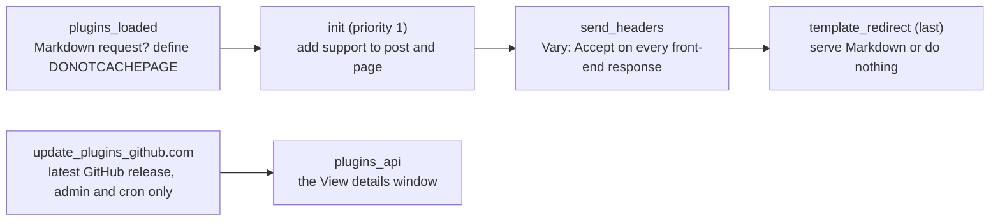
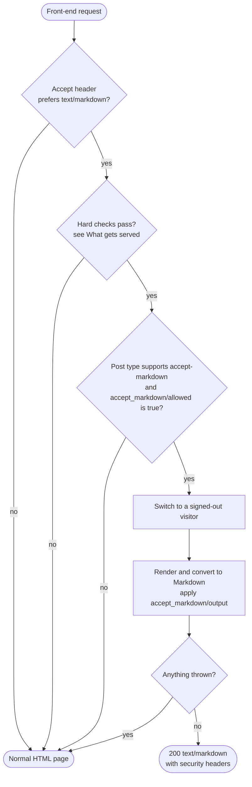
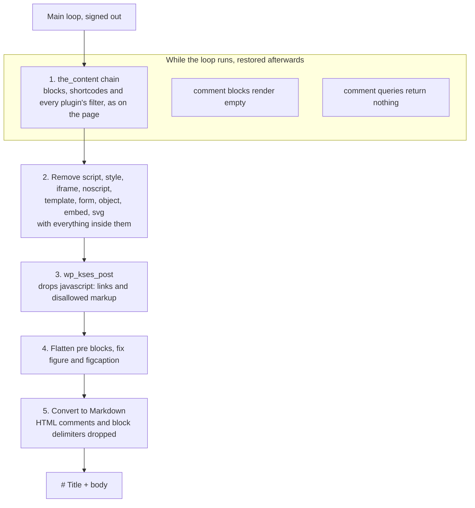
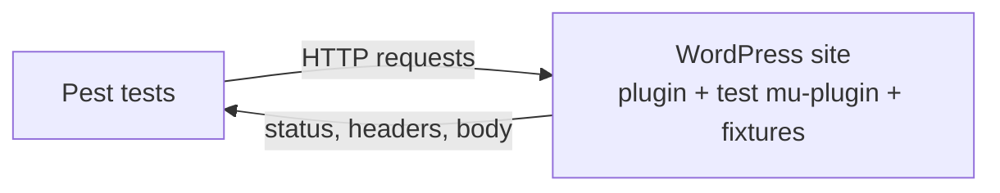

# Accept Markdown

A WordPress plugin that serves a public post as Markdown when the request's `Accept` header prefers `text/markdown`. Everything else gets the normal HTML page.

```console
$ curl -H 'Accept: text/markdown' https://example.com/hello-world/
# Hello world!

Welcome to WordPress. This is your first post.
```

It is built for AI agents, LLM tooling and scripts that want a post's content without parsing a theme's HTML. It is deliberately small: one PHP file, no settings, no tables, no new URLs.

- [Requirements](#requirements)
- [Installation](#installation)
- [How it works](#how-it-works)
- [What gets served](#what-gets-served)
- [Content negotiation](#content-negotiation)
- [Rendering](#rendering)
- [Response headers](#response-headers)
- [Configuration for developers](#configuration-for-developers)
- [Security model](#security-model)
- [Caching](#caching)
- [Known trade-offs](#known-trade-offs)
- [What it does not do](#what-it-does-not-do)
- [Development](#development)

## Requirements

- PHP 8.4 or later, with the `dom` and `xml` extensions
- WordPress 7.1.3 or later

WordPress refuses to activate the plugin on older versions, based on the plugin header.

## Installation

Copy `accept-markdown.php`, `readme.txt` and `vendor_prefixed/` into `wp-content/plugins/accept-markdown/` and activate the plugin. There is nothing to configure.

The plugin is not in the WordPress.org plugin directory, but it updates through the normal WordPress updater: the `Update URI` header makes WordPress ask the plugin instead of the directory, and the plugin checks the latest [GitHub release](https://github.com/teemujonkkari/accept-markdown/releases) twice a day. Only a release zip from this repository is ever offered; the package URL is built from the tag name and must match one of the release's assets. The "View details" window shows the release notes.

Posts and pages are served as Markdown straight away. Custom post types are not, until they opt in (see [Post types](#post-types)).

To check it works:

```sh
curl -s -D - -H 'Accept: text/markdown' https://example.com/any-published-post/
```

The response should have `Content-Type: text/markdown` and start with `# ` and the post title.

## How it works

The plugin registers six hooks. Three of them do almost nothing on a normal request, two run only in the admin for plugin updates, and the real work happens in `template_redirect`, after WordPress has resolved the URL to a post.



The handler runs at the last priority, so access gates that other plugins or the theme hook on `template_redirect`, such as login walls and maintenance modes, redirect or exit first.

On each front-end request, the handler decides between Markdown and doing nothing. "Do nothing" means WordPress carries on and renders the usual HTML page.



The hard checks always run first. Neither post type support nor the filter can override them.

## What gets served

A request gets Markdown only when every one of these is true:

| Check | Why |
|---|---|
| Method is `GET` or `HEAD` | Form posts and other methods behave as before |
| Not admin, REST, AJAX, cron or XML-RPC | The back end and APIs are never touched |
| Not a feed, preview or embed | Feeds, comment feeds, `/embed/` and previews stay as they are |
| The main query is a single post, page or CPT entry | Archives, search and listings are out of scope |
| Post status is exactly `publish` | Drafts, pending, scheduled and private posts never leak, even to signed-in users |
| The post type is publicly viewable | Internal post types can never be exposed |
| The post has no password | Checked on the post itself, so a visitor who knows the password still gets HTML |
| The post type supports `accept-markdown` | Posts and pages by default; CPTs must opt in |
| `accept_markdown/allowed` returns true | Per-post decisions |

The Markdown is then rendered as a **signed-out visitor**. WordPress includes private posts in queries for signed-in users who can read them, so without this a Latest Posts or Query Loop block inside a public post could list private titles. Rendering signed out guarantees the Markdown only contains what an anonymous visitor could see.

## Content negotiation

The plugin compares how much the client wants `text/markdown` against `text/html`, following [RFC 9110](https://www.rfc-editor.org/rfc/rfc9110#name-accept):

1. For each of the two types, find the most specific matching entry: an exact match beats `text/*`, which beats `*/*`. Among equally specific entries, the higher q-value wins.
2. Markdown is served only if its q-value is above 0 **and** strictly higher than HTML's. A tie goes to HTML.

Matching is case-insensitive, whitespace around `=` is ignored, q-values are clamped to the range 0 to 1, and a non-numeric q counts as 0.

| `Accept` header | Result |
|---|---|
| `text/markdown` | Markdown |
| `TEXT/Markdown` | Markdown |
| `text/html;q=0.5, text/markdown;q=0.9` | Markdown |
| `text/*;q=0.1, text/markdown` | Markdown |
| `text/html, text/markdown;q=0.5` | HTML |
| `text/markdown, text/html` | HTML (tie) |
| `text/markdown;q=0, */*` | HTML (Markdown refused) |
| `text/markdown;q=2, text/html` | HTML (q clamped to 1, tie) |
| A normal browser header, or `*/*` | HTML |
| No header, or `application/json` | HTML, never a 406 |

A header longer than 4096 bytes or with more than 32 entries is treated as "not Markdown", so a crafted header cannot cost noticeable CPU.

## Rendering

The content comes from the same `the_content` chain, in the main loop, that the signed-out HTML page uses. After that the plugin only removes things:



Notes on the chain:

- **Why the real chain.** Membership and paywall plugins (Paid Memberships Pro, MemberPress, Restrict Content Pro, Members, WooCommerce Memberships) gate published posts by filtering `the_content` or rewriting the post on `the_post`. Such a post is still published, viewable and unprotected, so only that chain knows it is gated. An earlier version rendered raw `post_content` through a private chain and served those posts in full. The rule now: the plugin removes from what the page renders and never reconstructs content.
- **Nested blocks go through the same chain.** A Query Loop with Post Content, a Post Excerpt or a Latest Posts excerpt calls `the_content` for the posts it renders, so the same gates apply to them.
- **Shortcodes and third-party filters run**, as on the page. Share buttons or related-post text can appear; see Known trade-offs.
- **Step 2 runs before kses on purpose.** kses deletes disallowed tags but keeps the text between them, which would put script source and CSS into the Markdown. An element with no closing tag removes everything after it, so malformed markup fails closed.
- **Code blocks** lose syntax-highlighter markup and become plain fenced code.
- **Tables** become Markdown pipe tables.
- **Images inside figures** are kept on their own line, followed by the caption.
- **The title** is entity-decoded, stripped of tags and collapsed to a single line, so it cannot inject extra Markdown structure.
- **Comments** (WordPress comments) are never queried or rendered: no comment text, authors, counts, forms or Latest Comments, even when the post contains comment blocks.

Output is `# <title>`, a blank line, then the body, with at most one blank line in a row.

The converter is [league/html-to-markdown](https://github.com/thephpleague/html-to-markdown) 5.1.4, bundled under the plugin-private `AcceptMarkdown\Vendor` namespace so another plugin shipping a different version cannot conflict with it.

## Response headers

A Markdown response is `200` with these headers:

| Header | Value | Purpose |
|---|---|---|
| `Content-Type` | `text/markdown; charset=<blog charset>` | Lets clients decode it |
| `Vary` | `Accept` | Caches key on the Accept header |
| `Cache-Control` | none, like the HTML page | The HTTP cache treats both representations the same; `no-store, private` when the `accept_markdown/cacheable` filter returns false |
| `X-Content-Type-Options` | `nosniff` | Browsers never sniff it as HTML |
| `Content-Security-Policy` | `default-src 'none'; sandbox` | Nothing in it can run, even if a browser renders it |
| `X-Robots-Tag` | `noindex` | Search engines do not index a duplicate |

`HEAD` returns the same status and headers with no body.

Every other front-end response gets `Vary: Accept` added and is otherwise unchanged.

## Configuration for developers

There are no settings. Behaviour is changed with standard WordPress calls and three filters.

### Post types

Eligibility per post type is the post type support feature `accept-markdown`. The plugin adds it to `post` and `page` on `init` at priority 1.

Opt a custom post type in when registering it:

```php
register_post_type('book', [
    'public' => true,
    'supports' => ['title', 'editor', 'accept-markdown'],
]);
```

Or add it later:

```php
add_action('init', fn () => add_post_type_support('book', 'accept-markdown'));
```

Opt any type out, including `post` and `page`, at the default `init` priority or later:

```php
add_action('init', fn () => remove_post_type_support('page', 'accept-markdown'));
```

Support is necessary but not sufficient. A post type that declares support still has to pass every hard check, so a non-viewable CPT is never served.

### `accept_markdown/allowed`

Decides per post. Receives the default (true when the post type has support) and the post.

```php
// Keep one post out of Markdown.
add_filter('accept_markdown/allowed', function (bool $allowed, WP_Post $post): bool {
    return $post->post_name === 'internal-notes' ? false : $allowed;
}, 10, 2);
```

It runs after the hard checks, so returning true cannot expose a draft, a private post or a password-protected post.

### `accept_markdown/output`

Changes the final Markdown string. Receives the Markdown and the post.

```php
// Add a source line at the end.
add_filter('accept_markdown/output', function (string $markdown, WP_Post $post): string {
    return $markdown . "\nSource: " . get_permalink($post) . "\n";
}, 10, 2);
```

If the filter throws, the visitor gets the normal HTML page.

### `accept_markdown/cacheable`

Decides whether the HTTP cache may store the Markdown response. Receives `true` and the post. Return false behind a CDN that ignores `Vary` (for example Cloudflare with a cache-everything rule), and the response is sent with `Cache-Control: no-store, private`.

```php
add_filter('accept_markdown/cacheable', '__return_false');
```

## Security model

The guiding rule: **the Markdown never exposes anything the public HTML page does not already expose.**

- Only the `Accept` header and the request method are read from the request. No query parameters, cookies or other headers.
- The only outbound request is the update check to the GitHub API, during admin and cron update checks, never on front-end requests. Only the tag name and the release notes (escaped before display) are read from the response; the package URL is built from the tag under this repository and must match a release asset.
- Hard eligibility checks run before, and independently of, post type support and the filter.
- Rendering happens as a signed-out visitor.
- Content comes from the same `the_content` chain, in the main loop, that the signed-out HTML page uses, so membership and paywall gates apply to the Markdown.
- Rendered HTML passes through the same post kses rules WordPress uses for untrusted authors, even when the content was written by a user with `unfiltered_html`.
- Non-content elements are removed with their contents before conversion.
- HTML comments and block delimiters are dropped.
- Any exception during rendering falls back silently to the normal HTML response, with no error details in the body.
- The plugin creates no options, tables, cron jobs, rewrite rules or admin screens. The one site transient (the cached update check, `accept_markdown_release`) expires by itself, so there is nothing to clean up on uninstall.

## Caching

The same URL serves two representations, so caches must not mix them up:

- Every front-end response carries `Vary: Accept`, which standards-compliant caches honour. They store Markdown and HTML as separate variants of the URL and serve each to the clients that asked for it, so Markdown is cached exactly like the HTML page. The plugin sends no `Cache-Control` of its own.
- On Markdown requests the plugin defines `DONOTCACHEPAGE`, which WordPress page-cache plugins such as WP Super Cache respect. They key on the URL alone, so they must not store Markdown at all.
- Behind a CDN that ignores `Vary`, return false from `accept_markdown/cacheable` and Markdown is sent with `Cache-Control: no-store, private` instead.

The result on Seravo, the primary hosting target: the first Markdown request for a post hits PHP, every later one is served by Nginx until the page is purged, and browsers never see a Markdown variant.

### Cache compatibility

Two questions for any cache: does it keep the two representations apart (`Vary: Accept`), and does it answer before WordPress runs?

| Cache | Markdown cached | Markdown to visitors | HTML to agents | Notes |
|---|---|---|---|---|
| Nginx cache on Seravo | Yes | Never | No | Honours the standard `Vary` header. Tested on a production site, works without configuration. |
| WP Super Cache and other `advanced-cache.php` plugins | No | Never | Possible | They answer before `plugins_loaded`, so a cached HTML page is served to Markdown requests. `DONOTCACHEPAGE` keeps Markdown out of the cache. |
| LiteSpeed Cache (LSCache) | No | Never | Yes, until configured | The server answers from its cache before PHP runs and does not key on `Vary: Accept`. The plugin respects `DONOTCACHEPAGE`, so Markdown is never stored. Add the rewrite rule below. |
| Varnish, Nginx FastCGI cache with `Vary` ignored, other server-level caches | Depends | Possible | Possible | If the cache ignores `Vary`, return false from `accept_markdown/cacheable` and bypass the cache when the `Accept` header mentions `text/markdown`, or configure the cache to key on `Accept`. |
| Cloudflare and CDNs that ignore `Vary` | Depends | Possible | Possible | Cloudflare does not cache HTML by default, so there is nothing to mix up. With a cache-everything rule, return false from `accept_markdown/cacheable` and tell the CDN to bypass or vary on `Accept`. |

**LiteSpeed Cache.** Add this to the site's `.htaccess`, above the WordPress block:

```apache
<IfModule LiteSpeed>
RewriteEngine On
RewriteCond %{HTTP:Accept} text/markdown [NC]
RewriteRule .* - [E=Cache-Control:no-cache]
</IfModule>
```

Requests whose `Accept` header mentions Markdown bypass the cache and reach WordPress, which negotiates as usual. Markdown is not stored by LiteSpeed (it respects `DONOTCACHEPAGE`), so a bypass is enough. Requests that mention Markdown with a low preference also bypass the cache and get uncached HTML, which is harmless.

To verify any cache, request the same URL twice as a browser and once as an agent, and compare the cache status header (`X-LiteSpeed-Cache`, `X-Cache`, `X-Proxy-Cache` or similar) and the content type:

```bash
curl -sI https://example.com/post/ | grep -i -E 'x-.*cache|content-type'
curl -sI -H 'Accept: text/markdown' https://example.com/post/ | grep -i -E 'x-.*cache|content-type'
```

The browser request should turn into a cache hit on the second run. The agent request should never be a hit and should report `text/markdown`.

## Known trade-offs

- **Third-party `the_content` output appears.** Share buttons, related posts and similar text from other plugins can end up in the Markdown. Everything they add already appears on the public page. The alternative, a private rendering chain, bypassed membership plugins' content gates, so this is a deliberate choice. Trim with the `accept_markdown/output` filter if needed.
- **Dynamic blocks are kept.** Latest Posts, Query Loops and similar blocks render as on the public page. Because rendering is signed out, they only show public content.
- **Third-party `render_block` filters run.** Their output can reach the Markdown. That output already appears on the public HTML page.
- **Embeds render as on the page.** An embed whose markup is only an iframe (for example YouTube) is removed with the iframe and leaves nothing. Embeds with a fallback blockquote keep their text and link.
- **Caches that answer early can serve HTML to agents.** A cache that serves from `advanced-cache.php`, or a server-level cache such as LiteSpeed that answers before PHP runs, responds before plugins load, so a Markdown request can get a cached HTML page. The reverse never happens, because Markdown is never stored. See [Cache compatibility](#cache-compatibility).
- **A Markdown request whose rendering throws** falls back to the signed-out version of the HTML page.

## What it does not do

- No `.md` URLs, `?format=markdown` or any other new URL or rewrite rule.
- No Markdown feeds, archives, category, tag, author, search or front-page listing output.
- No comments in any form.
- No 406 responses.
- No advertising of the Markdown version (no `Link` header or `<link rel="alternate">`).
- No front matter or metadata (author, dates, taxonomies). Use `accept_markdown/output` if you need it.
- No conversion cache, settings page, options or WP-CLI commands.
- No rate limiting; that belongs to the web server or CDN.

## Development

### Layout

```text
accept-markdown.php          The whole plugin
readme.txt                   WordPress.org plugin readme
vendor_prefixed/             Prefixed converter (built, shipped)
composer.json, composer.lock Pinned dependencies and scripts
scoper.inc.php               php-scoper config for the prefixed build
phpunit.xml                  Test suite config
tests/
  Pest.php                   HTTP request helpers
  *Test.php                  Black-box HTTP tests
  fixtures.php               Test content, run with wp eval-file
  accept-markdown-test.php   Test mu-plugin (CPTs, shortcode, filters)
bin/release                  Bumps the version, commits and tags a release
.github/workflows/release.yml  Builds the zip and publishes the GitHub release on a v* tag
SPEC.md                      The specification
CLAUDE.md, docs/agents/      Instructions for coding agents (issue tracker, triage labels, domain docs)
```

For local development, symlink the repo into a site's `wp-content/plugins/accept-markdown`.

Only `accept-markdown.php`, `readme.txt`, `LICENSE` and `vendor_prefixed/` belong in a release. `vendor/` holds dev tools.

### Build

```sh
composer install
composer build    # prefixes league/html-to-markdown into vendor_prefixed/
composer audit
```

The build is reproducible: running `composer build` twice gives identical output.

### Tests

All tests are black-box HTTP requests against a running WordPress site. They assert only on status, headers and body, and never call plugin code directly.



Security tests use marker strings: each piece of content that must never reach Markdown (a draft, a script, a shortcode's output, a private post's title) carries a unique marker, and the tests check it is absent. Markers use letters only, because Markdown escapes `_` and would hide a leak from a plain string search.

Run them from a shell that can reach the site's database (for Local, the "Open site shell"):

```sh
export ACCEPT_MARKDOWN_TEST_PASSWORD=any-value
wp eval-file tests/fixtures.php    # installs the test mu-plugin and creates or updates fixtures
composer test
```

`ACCEPT_MARKDOWN_TEST_PASSWORD` sets the password of the `am-test-admin` user that the signed-in tests use; any value works as long as both commands see the same one. `ACCEPT_MARKDOWN_BASE_URL` points the tests at a different site (default `http://accept-markdown.local`).

The fixture file is idempotent. It finds content by slug, creates it when missing and updates it otherwise. It never deletes anything.

### Release

Versions follow semver from the commit types: `feat` bumps minor, `fix`, `docs` and `perf` bump patch, a breaking change bumps major.

1. Add a `= X.Y.Z =` entry to the changelog in `readme.txt`. It becomes the GitHub release notes.
2. Run `bin/release X.Y.Z`. It checks that the tree is clean, on `main` and that `vendor_prefixed/` matches `composer build`, then sets the version in the plugin header and `readme.txt`, commits and tags `vX.Y.Z`.
3. Push: `git push origin main vX.Y.Z`.

The tag triggers `.github/workflows/release.yml`, which verifies the version, zips `accept-markdown.php`, `readme.txt`, `LICENSE` and `vendor_prefixed/` under an `accept-markdown/` folder and publishes a GitHub release with the zip attached. Install it by uploading the zip in WordPress or unpacking it into `wp-content/plugins/`.

The test mu-plugin is for test sites only. It registers test post types and a shortcode, hooks both filters, adds a login wall for `?am_test=gated` and two membership-style content gates, and turns off canonical redirects.

## License

MIT. See `LICENSE`. The bundled converter, league/html-to-markdown, is MIT as well (`vendor_prefixed/LICENSE`).
